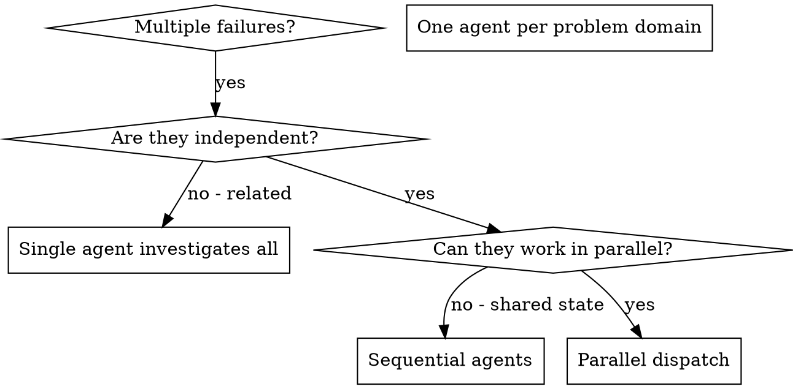

# Dispatching Parallel Agents

## Overview

You delegate tasks to specialized agents with isolated context. By precisely crafting their instructions and context, you ensure they stay focused and succeed at their task. They should never inherit your session's context or history — you construct exactly what they need. This also preserves your own context for coordination work.

When you have multiple unrelated failures (different test files, different subsystems, different bugs), investigating them sequentially wastes time. Each investigation is independent and can happen in parallel.

**Core principle:** Dispatch one agent per independent problem domain. Let them work concurrently.

## When to Use



**Use when:**
- 3+ test files failing with different root causes
- Multiple subsystems broken independently
- Each problem can be understood without context from others
- No shared state between investigations

**Don't use when:**
- Failures are related (fix one might fix others)
- Need to understand full system state
- Agents would interfere with each other

## The Pattern

### 1. Identify Independent Domains

Group failures by what's broken:
- File A tests: Tool approval flow
- File B tests: Batch completion behavior
- File C tests: Abort functionality

Each domain is independent - fixing tool approval doesn't affect abort tests.

### 2. Create Focused Agent Tasks

Each agent gets:
- **Specific scope:** One test file or subsystem
- **Clear goal:** Make these tests pass
- **Constraints:** Don't change other code
- **Expected output:** Summary of what you found and fixed

### 3. Dispatch in Parallel

```typescript
// In Claude Code / AI environment
Task("Fix agent-tool-abort.test.ts failures")
Task("Fix batch-completion-behavior.test.ts failures")
Task("Fix tool-approval-race-conditions.test.ts failures")
// All three run concurrently
```

### 4. Review and Integrate

When agents return:
- Read each summary
- Verify fixes don't conflict
- Run full test suite
- Integrate all changes

## Agent Prompt Structure

Good agent prompts are:
1. **Focused** - One clear problem domain
2. **Self-contained** - All context needed to understand the problem
3. **Specific about output** - What should the agent return?

```markdown
Fix the 3 failing tests in src/agents/agent-tool-abort.test.ts:

1. "should abort tool with partial output capture" - expects 'interrupted at' in message
2. "should handle mixed completed and aborted tools" - fast tool aborted instead of completed
3. "should properly track pendingToolCount" - expects 3 results but gets 0

These are timing/race condition issues. Your task:

1. Read the test file and understand what each test verifies
2. Identify root cause - timing issues or actual bugs?
3. Fix by:
   - Replacing arbitrary timeouts with event-based waiting
   - Fixing bugs in abort implementation if found
   - Adjusting test expectations if testing changed behavior

Do NOT just increase timeouts - find the real issue.

Return: Summary of what you found and what you fixed.
```

## Do NOT pass `name:` unless you need to message the agent mid-flight

**This is the single highest-cost mistake in this skill.** `name:` silently changes
the delivery contract, and it fails in the direction where a lost report looks like a
clean result.

| Dispatch | Report reaches you | On-disk transcript |
|---|---|---|
| `Agent({prompt, subagent_type})` — **unnamed** | **automatically**, in the completion notification's `<result>` | yes, at `output_file` |
| `Agent({prompt, subagent_type, name: "x"})` | **only if the agent itself calls `SendMessage`** | **none** |

A named agent becomes an `in_process_teammate`. Its final text is not a return value —
it goes nowhere unless the agent chooses to send it. When it doesn't, the report is
**gone permanently**: teammates leave no transcript, no output file, nothing keyed to
their task id, so there is nothing to recover.

What you get instead is an `idle_notification` with `"idleReason":"available"`. That is
**not** a completion signal and carries no result. It is byte-identical whether the
agent did brilliant work and forgot to send it, or found nothing, or died early.

Measured 2026-08-18: three adversarial review agents were dispatched with `name:`. One
delivered, and only after being chased twice. Two produced four idle pings between them
and nothing else; their work is unrecoverable. Verified by control test — an unnamed
agent's report arrived in the completion `<result>` with no cooperation required, and
`find` located a transcript for it and **zero** files for any of the three teammates.

**Rules:**

1. **Default to unnamed.** Name an agent only when you genuinely need to `SendMessage`
   it while it runs. Review, research, and analysis agents almost never need this.
2. **If you must name one, instruct it to `SendMessage` its report explicitly** — and
   still treat that as best-effort, because two of three ignored exactly that
   instruction.
3. **Never read silence as a pass.** An agent that idles without a report has reported
   nothing. Chase it once; if it idles again, record "did not deliver" and do the
   verification yourself. Do not let a missing review read as a clean review — on
   2026-08-18 chasing the one agent that did deliver is what caught a PR carrying an
   illegitimate CI override and a `baseline.json` that would have rewound dev's quality
   ledger.
4. **`scripts/agent-report.sh` does not exist.** Older notes claim it recovers lost
   reports; it does not, and could not help for teammates regardless.

## Common Mistakes

**❌ Too broad:** "Fix all the tests" - agent gets lost
**✅ Specific:** "Fix agent-tool-abort.test.ts" - focused scope

**❌ Named for no reason:** `name: "reviewer"` - report delivery becomes opt-in and a
lost report is indistinguishable from a clean one
**✅ Unnamed:** report returns automatically and leaves a transcript

**❌ No context:** "Fix the race condition" - agent doesn't know where
**✅ Context:** Paste the error messages and test names

**❌ No constraints:** Agent might refactor everything
**✅ Constraints:** "Do NOT change production code" or "Fix tests only"

**❌ Vague output:** "Fix it" - you don't know what changed
**✅ Specific:** "Return summary of root cause and changes"

## When NOT to Use

**Related failures:** Fixing one might fix others - investigate together first
**Need full context:** Understanding requires seeing entire system
**Exploratory debugging:** You don't know what's broken yet
**Shared state:** Agents would interfere (editing same files, using same resources)

## Real Example from Session

**Scenario:** 6 test failures across 3 files after major refactoring

**Failures:**
- agent-tool-abort.test.ts: 3 failures (timing issues)
- batch-completion-behavior.test.ts: 2 failures (tools not executing)
- tool-approval-race-conditions.test.ts: 1 failure (execution count = 0)

**Decision:** Independent domains - abort logic separate from batch completion separate from race conditions

**Dispatch:**
```
Agent 1 → Fix agent-tool-abort.test.ts
Agent 2 → Fix batch-completion-behavior.test.ts
Agent 3 → Fix tool-approval-race-conditions.test.ts
```

**Results:**
- Agent 1: Replaced timeouts with event-based waiting
- Agent 2: Fixed event structure bug (threadId in wrong place)
- Agent 3: Added wait for async tool execution to complete

**Integration:** All fixes independent, no conflicts, full suite green

**Time saved:** 3 problems solved in parallel vs sequentially

## Key Benefits

1. **Parallelization** - Multiple investigations happen simultaneously
2. **Focus** - Each agent has narrow scope, less context to track
3. **Independence** - Agents don't interfere with each other
4. **Speed** - 3 problems solved in time of 1

## Verification

After agents return:
1. **Review each summary** - Understand what changed
2. **Check for conflicts** - Did agents edit same code?
3. **Run full suite** - Verify all fixes work together
4. **Spot check** - Agents can make systematic errors

## Real-World Impact

From debugging session (2025-10-03):
- 6 failures across 3 files
- 3 agents dispatched in parallel
- All investigations completed concurrently
- All fixes integrated successfully
- Zero conflicts between agent changes
